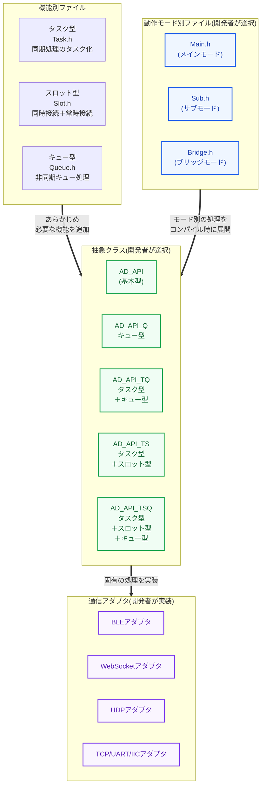

# 1. 通信アダプタのクラス設計

通信アダプタは、その特性を理解し、目的に合った方式で設計します。
理解すべき内容はいくつかの切り口があります。

---
## §データ受信のタイミング
通信種類により、データを受信するタイミングが異なります。
対象の通信種類が、どれに該当するか把握します。

### ① 同期受信（分類と把握）
同期処理でデータ受信する方式です。
**該当：UART/TCP/IIC/UDP/HTTP**

### ② 非同期受信（コールバック）
コールバック方式でデータ受信する方式です。
**該当：BLE/ESP-NOW/WebSocket**

### ③ 非同期受信（タスク）
前述の`同期受信`をRTOSを用いて、開発者が並列処理させる方式です。

---
## §受信の多重度（分類と把握）
通信種類により、一度に接続する数が異なります。
対象の通信種類が、どれに該当するか把握します。

### ① 単一オブジェクト
**ひとつの接続オブジェクトでひとつ以上の接続元と通信**する方式です。
接続オブジェクトを共有する為、接続元を特定する情報を持っています。
**該当：IIC/UDP/BLE/ESP-NOW/WebSocket/HTTP**

#### ② 複数オブジェクト
**接続元ごとの接続オブジェクトで通信**する方式です。
つまり、ひとつの通信方式で複数の接続元が同時に通信します。
接続オブジェクト自体が、接続元を特定する情報になります。
**該当：UART/TCP**

---
## §処理方式（実装方式を理解）
通信種類によっては、複数の処理方式で実装することが出来ます。
対象の通信種類が、どれで実装できるか把握します。
最終的に、いずれかの方式で実装することになります。

### ① 要求応答方式（単一型）
`同期受信`・`単一接続オブジェクト`の通信で利用できます。
`要求`単位で`要求コマンドの実行`・`実行結果の送信`をおこないます。

### ② 要求応答方式（スロット型）
`同期受信`・`複数接続オブジェクト`の通信で利用できます。
`接続オジェクト`単位に`基本型`と同様の処理をおこないます。
個々の`接続オブジェクト`は、`接続スロット`と呼ぶ情報レコードで管理します。
各`接続スロット`を巡回して処理します。

### ③ 非同期キュー方式（単一型）
`非同期受信`・`単一接続オブジェクト`の通信で利用できます。
非同期でデータ受信しながら、`要求`・`接続元を特定する情報(接続識別子)`をキューに登録します。
登録したキューは、同期処理側で順次応答します。
`要求コマンドの実行`あと、`接続識別子`で接続元を特定し、`実行結果`を送信します。
なお、`コールバック式`は`接続識別子`を数値や文字で扱います。
一方、`非同期受信（タスク）式`では、`接続オブジェクト`で扱います。

### ④ 非同期キュー方式（スロット型）
`非同期受信`・`単複数接続オブジェクト`の通信で利用できます。
内容は`単一型`と同様ですが、`接続スロット`管理を交えながら処理を進めます。

---
## §目的別（実装方式の選定条件）
用途・目的に応じて、高速性・多機能性・速度の平準化などの基準を設けます。
基準が決まれば、それに従い処理方式を決めます。

### ① 接続の容易さ
MMPとの接続による利便性を考慮します。
USBケーブル/ジャンパ・ケーブル/Groveケーブルでの優先通信、各種の無線通信といったものがあります。

### ② 通信速度
USBケーブル接続が最速、無線であればESP-NOWが最速です。
特定の分野に特化し、同時接続数を絞ることも考慮します。

### ② 運用状況
見通せる範囲、遠距離、インターネット越し、ケーブルレスによる事故防止など、運用状況や制約にあったスタイルを考慮します。

---
# ２. 通信アダプタができるまで

通信アダプタは、あらかじめ用意された`抽象クラス`を利用して作成します。
`抽象クラス`は、幾つかの`機能`や`動作モード`の組み合わせで構成されます。

##### 機能パーツの選択（ベース抽象クラス）
通信の特性（同期か非同期か、接続スロットが必要か）に合わせた、抽象クラス（`AD_API`～`AD_API_TSQ`）をが用意されています。これらは、機能別に分割したソースファイル(`Queue.h`/`Slot.h`/`Task.h`)が事前にインクルードされていることで、実現しています。
##### 動作モードの選択
開発者がコンパイルオプションから動作モード（`メイン`/`サブ`/`ブリッジ`）を選びます。コンパイル時に、動作モードに従い関数群が構成されます。これらは、モード別に分割したソースファイル(Main.h/Sub.h/Bridge.h)をプリプロセッサが適切にインクルードすることで、実現しています。
##### 具象クラスとしての完成
開発者が通信アダプタの特性に合わせて、純粋仮想関数やダミー実装の関数（ON_RECIVEやSEND_RESULTなど）を実装して、完成します。

---
### 2-1. 抽象クラスの機能構成
抽象クラスを構成する機能は次の4つがあります。
各機能には、目的に合わせた関数群が備わっています。

|所有元|関数種別|関数名|説明|有無制御|①基本型|②タスク型|③スロット型|④キュー型|
|------|--------|------|----|--------|--------|----------|------------|----------|
|①|**純粋仮想**|**`handle()`**|**ハンドル全体の処理**|－|**(未定義)**|①を継承|①を継承|**非同期キュー方式で実装**|
||仮想|**`CONSTRACT()`**|コンストラクタの個別差分 ※不要な場合はダミー処理が残る|－|(ダミー処理)|①を継承|①を継承|①を継承|
||仮想|**`SEND_REQUEST()`**|スレーブが自身にリクエストを送信 ※不要な場合はダミー処理が残る|ブリッジ|(ダミー処理)|①を継承|①を継承|①を継承|
|||||ブリッジ以外|-なし-|-なし-|-なし-|-なし-|
||仮想|**`SEND_RESULT()`**|接続元に処理結果を送信 ※スレーブではダミー処理が残る|－|(ダミー処理)|①を継承|①を継承|①を継承|
||仮想|**`SETUP_OPTION()`**|ハンドル初期化の個別差分 ※不要な場合はダミー処理が残る|－|(ダミー処理)|①を継承|①を継承|①を継承|
||メンバ|**`SETUP()`**|ハンドル初期化の基本分|－|・WiFiの稼働状況を確認 ・`SETUP_OPTION()`を実行|①を継承|①を継承|①を継承|
||仮想|**`WORKFLOW()`**|マスタとスレーブの連携フローを制御|ブリッジ|**スレーブ用の処理**|①を継承|①を継承|①を継承|
|||||ブリッジ以外|-なし-|-なし-|-なし-|-なし-|
||仮想|**`RUN_PROCESS()`**|キュー応答|メイン|**メイン用の処理**|①を継承|①を継承|①を継承|
|||||サブ|**サブ用の処理**|①を継承|①を継承|①を継承|
|||||ブリッジ|**スレーブ用の処理**|①を継承|①を継承|①を継承|
|②|**純粋仮想**|**`ON_RECIVE()`**|**受信データの取込**|－|－|**(未定義)**|－|－|
||メンバ|**`LOOP_RECIVE()`**|**上記のループ化**|－|－|**protectで実装**|－|－|
||**必須を コメントで喚起**|**`TASK_RECIVE()`**|**上記のタスク化準備**|－|－|**(未定義)**|－|－|
||メンバ|**`RUN_TASK()`**|**上記のタスク開始**|－|－|**protectで実装**|－|－|
|③|メンバ|**`SLOT_SET()`**|**スロット内容をセット**|－|－|－|**protectで実装**|－|
||〃|**`SLOT_GET_ACTIVE()`**|**活性スロットIDを取得**|－|－|－|**〃**|－|
||〃|**`SLOT_GET_FREE()`**|**空きスロットIDを取得**|－|－|－|**〃**|－|
||〃|**`SLOT_GET_OLD()`**|**古いスロットIDを取得**|－|－|－|**〃**|－|
|④|メンバ|**`pushQueue()`**|**キューの登録**|－|－|－|－|**protectで定義**|
||〃|**`popQueue()`**|**キューの取得**|－|－|－|－|**〃**|

(補足)
- **有無制御**は、**プリプロセッサ**で制御しています。
- `純粋仮想関数` `仮想関数` は必要に応じて、`継承`または`実装(オーバーライド)`します。
- `非同期キュー型`,`接続スロット型`は、 **固有の処理方式を『非公開の`メンバ関数`』** として所有します。
- `接続スロット型`には純粋仮想関数`ON_RECIVE()`を所有し、**アダプタ側でデータ受信の実装が必須**です。
- ②③を多重継承する際、**仮想継承により資源衝突を回避**しています。

### 2-2. 抽象クラスの種類
各抽象クラスは、次のように目的ごとに用意されています。
通信の特性（同期か非同期か、接続スロットが必要か）に合わせて、どの抽象クラスを利用するかを開発者が選択します。

|組合せ|クラス名  |解説|通信アダプタ|
|------|----------|----|------------|
|基本型|AD_API    |他の型にあてはまらない`特殊な場合`に利用します。 `機能①`をベースに、殆どを作り込みます。|UART(高速版) HTTP|
|Q型   |AD_API_Q  |`接続スロットが不要`で、`コールバック方式でデータ受信`する場合に利用します。 受信時に要求をキュー登録し、同期タスク側で順次キューに応答します。|BLE ESP-NOW WebScket|
|TQ型  |AD_API_TQ |`接続スロットが不要`で、`同期処理のデータ受信をタスク化`する場合に利用します。 受信時に要求をキュー登録し、同期タスク側で順次キューに応答します。|UDP|
|TS型  |AD_API_TS |`接続スロットが必要`で、`同期処理のデータ受信`の場合に利用します。 `複数同時に常時接続`する通信を**高速化**する場合に向きます。|TCP(高速版)|
|TSQ型 |AD_API_TSQ|`接続スロットが必要`で、`同期処理のデータ受信をタスク化`する場合に利用します。 受信時に要求をキュー登録し、同期タスク側で順次キューに応答します。 `複数同時に常時接続`する通信を**全体処理速度を平準化**する場合に向きます。|UART TCP IIC|

### 2-3. 抽象クラスの実装状態

機能を組み合わせた結果、抽象クラスには`実装済`と`それ以外`が混在します。
`未実装`・`ダミー実装`は、開発者が**通信アダプタ側で実装**する必要があります。

|関数名             |基本型  |Q型     |TQ型    |TS型    |TSQ型   |
|-------------------|--------|--------|--------|--------|--------|
|`handle()`         |未定義①|実装済④|実装済④|未定義①|実装済④|
|`CONSTRACT()`      |**ダミー①**|**ダミー①**|**ダミー①**|**ダミー①**|**ダミー①**|
|`SEND_REQUEST()`   |**ダミー①**|**ダミー①**|**ダミー①**|**ダミー①**|**ダミー①**|
|`SEND_RESULT()`    |**ダミー①**|**ダミー①**|**ダミー①**|**ダミー①**|**ダミー①**|
|`SETUP_OPTION()`   |**ダミー①**|**ダミー①**|**ダミー①**|**ダミー①**|**ダミー①**|
|`SETUP()`          |実装済①|実装済①|実装済①|実装済①|実装済①|
|`WORKFLOW()`       |実装済①|実装済①|実装済①|実装済①|実装済①|
|`RUN_PROCESS()`    |実装済①|実装済①|実装済①|実装済①|実装済①|
|`ON_RECIVE()`      |-なし-  |-なし-  |**未定義②**|**未定義②**|**未定義②**|
|`LOOP_RECIVE()`    |-なし-  |-なし-  |実装済②|実装済②|実装済②|
|`TASK_RECIVE()`    |-なし-  |-なし-  |**未定義②**|**未定義②**|**未定義②**|
|`RUN_TASK()`       |-なし-  |-なし-  |実装済②|実装済②|実装済②|
|`SLOT_SET()`       |-なし-  |-なし-  |-なし-  |実装済③|実装済③|
|`SLOT_GET_ACTIVE()`|-なし-  |-なし-  |-なし-  |実装済③|実装済③|
|`SLOT_GET_FREE()`  |-なし-  |-なし-  |-なし-  |実装済③|実装済③|
|`SLOT_GET_OLD()`   |-なし-  |-なし-  |-なし-  |実装済③|実装済③|
|`pushQueue()`      |-なし-  |実装済④|実装済④|-なし-  |実装済④|
|`popQueue()`       |-なし-  |実装済④|実装済④|-なし-  |実装済④|

(補足)
- 抽象クラスはテンプレートクラスであるため、通信アダプタのクラスでは、クラス宣言・コンストラクタで型指定(**接続識別子のデータ型**)が必要になります。
- 関数の中には、実装が必須ではないものもあります。